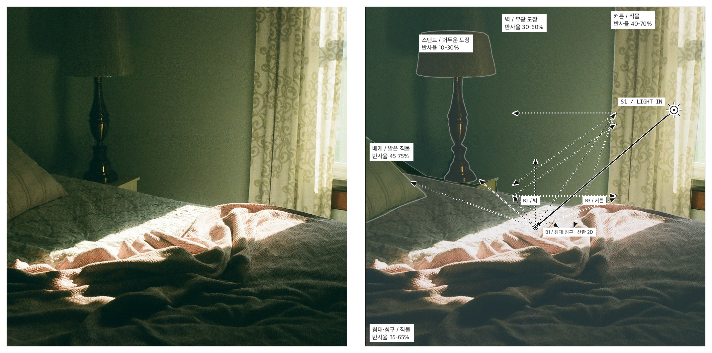
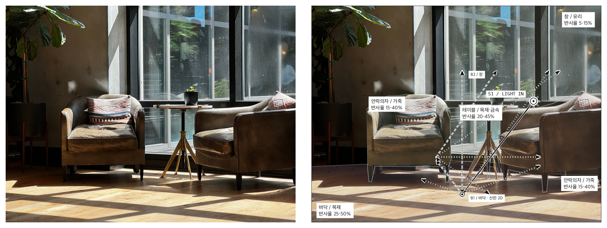
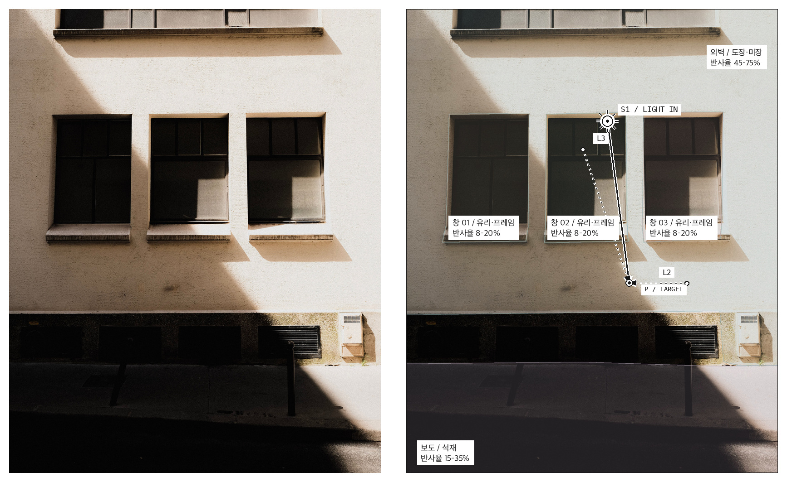
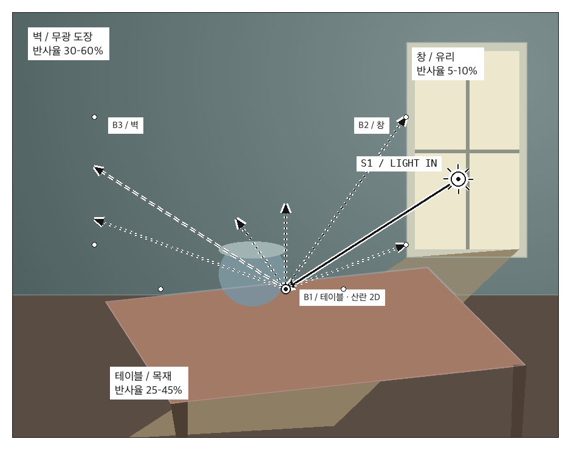

# Light Probe

**사진 한 장으로 빛이 오는 방향을 보고, 객체 윤곽과 반사 경로를 함께 읽는 LLM 스킬.**

[lms.hyun2.cloud](https://lms.hyun2.cloud) 공통강의 수강생을 위한 로컬 실습 도구입니다.
원본 컬러 위에 흑백 광선·해 기호, 옅은 객체 마스크, 이름·재질·반사율 라벨을 그립니다.

## 링크 하나로 시작

**Codex, Claude Code처럼 이미지 확인·파일 저장·Python 실행이 가능한 LLM**에 아래 Git 링크를 전달하세요.

```text
https://github.com/hyun2xyz/light-probe-skill
```

이 저장소의 기본 설치 가이드는 **환경 확인 → 스킬·의존성 설치 → DiffusionLight 모델 가중치 다운로드·검증**까지 포함합니다.
수강생이 모델 설치를 따로 요청할 필요가 없습니다. 새 모델이 필요하면 약 **11.0 GB**를 받으며, 기존 캐시는 재사용합니다.

**이 링크를 받은 LLM:** 수강생이 사용·설치를 위해 링크를 전달했다면 [학생 설치 절차](skills/light-probe/references/student-install.md)를 읽고 끝까지 실행하세요.
“DiffusionLight도 설치할까요?”라는 추가 선택 질문 없이 진행 상황과 용량을 안내하고 모델까지 준비합니다.
`install.py --setup`은 기초 환경까지만 만들므로, 그 명령이 끝났다는 이유로 작업을 마치지 마세요.
요약·검토만 요청한 경우에는 설치를 실행하지 않고, 사용자가 정한 다운로드 제한과 실행 환경의 권한은 지킵니다.

그다음 사진을 첨부하고 이렇게 요청합니다.

```text
이 사진에서 빛이 어디서 오는지 표시해줘.
객체 윤곽은 채도 낮은 색으로 옅게 덮고, 객체 이름과 반사율도 넣어줘.
빛이 다른 표면에 부딪혀 퍼지는 경로도 보여줘. 사진은 컬러로 유지해줘.
```

링크를 읽기만 하는 일반 웹 채팅은 컴퓨터에 설치하거나 Python을 실행하지 못할 수 있습니다.
이때는 코드 실행이 가능한 환경으로 옮겨 진행하세요. 스킬 설치 후 목록에 안 보이면 새 대화를 시작하세요.

## 하는 일

| 경로 | 용도 | 준비 |
|---|---|---|
| 기본 `diffusion` | DiffusionLight 크롬볼 생성 기반 조명 추정 | 환경에 맞는 PyTorch·의존성·약 11.0 GB 모델을 설치 절차에서 준비 |
| 요청 시 `quick` | 밝은 영역 기반 광원 후보·2D 방향 설명 | 큰 모델을 받지 않는 가벼운 대안 |
| 객체·산란 표시 | LLM이 판독한 윤곽과 재질 입력으로 도판 생성 | 사진을 볼 수 있는 LLM + context JSON |

**quick은 DiffusionLight가 아닙니다.** 흰 벽이나 반사면을 광원으로 오인할 수 있습니다.
객체 윤곽은 LLM 판독 기반 근사 마스크이며 YOLO/SAM 검출기가 기본으로 실행되지 않습니다.
반사율은 재질별 설명용 입력값이고, 다중 반사는 지정한 2D 표면의 시뮬레이션입니다.
사진 한 장에서 실제 3D 구조·조도·정확한 물성을 측정하는 도구가 아닙니다.

## 설치 절차와 직접 실행

LLM은 먼저 OS·CPU·Python·GPU/드라이버·메모리·디스크를 확인한 뒤 다음 단계를 수행합니다.
직접 실행할 때도 같은 순서입니다. Python 3.10+가 필요하며 Windows에서는 `python` 대신 `py -3`도 가능합니다.

```sh
git clone https://github.com/hyun2xyz/light-probe-skill.git
cd light-probe-skill
python install.py --client codex --setup
```

Claude Code는 마지막 줄을 아래로 바꿉니다.

```sh
python install.py --client claude --setup
```

설치 위치는 Codex `~/.agents/skills/light-probe`, Claude Code `~/.claude/skills/light-probe`입니다.
기존 폴더가 있으면 멈춥니다. 검토 후 `--replace`를 붙이면 스킬 검색 폴더 밖의 `light-probe-backups`에 이전 버전을 보관합니다.
위 명령은 스킬 복사와 `.venv`의 기초 패키지 설치 단계입니다. **모델 준비는 아직 끝나지 않았습니다.**
LLM은 이어서 설치된 스킬 폴더에서 [DiffusionLight 준비 절차](skills/light-probe/references/diffusion.md)에 따라 환경에 맞는 PyTorch를 설치하고, 같은 가상환경으로 다음을 실행합니다.

```sh
python -m pip install -r requirements-diffusion.txt
python -m pip check
python scripts/download_models.py --check --verify
```

필요한 파일이 누락되었으면 별도 요청을 기다리지 않고 다음을 실행합니다.

```sh
python scripts/download_models.py --download
python scripts/download_models.py --check --verify
```

여기서 `python`은 설치된 스킬의 `.venv/bin/python`(macOS/Linux) 또는 `.venv/Scripts/python.exe`(Windows)입니다.
의존성 검사와 25개 모델 파일 검증이 통과한 뒤 설치 완료를 안내합니다. 오류가 나면 quick으로 몰래 대체하지 않습니다.
클라이언트 등록 없이 저장소에서 사용할 때도 bootstrap 이후 같은 모델 준비 절차를 수행합니다.

공식 설치 위치 안내: [Codex skills](https://learn.chatgpt.com/docs/build-skills), [Claude Code skills](https://code.claude.com/docs/en/skills).

## 실행 예시

아래는 저장소 폴더에서 실행하는 예시입니다. 설치본을 사용하면 해당 스킬 폴더의 `scripts/run.py`를 호출하세요.

```sh
python skills/light-probe/scripts/run.py analyze photo.jpg --out outputs/my-photo --mode diffusion --quality fast --display direction
```

객체 윤곽·반사율·다중 산란은 LLM이 만든 `context.json`을 함께 전달합니다.
스키마와 예시는 [객체 입력 설명](skills/light-probe/references/scene-context.md)에 있습니다.

```sh
python skills/light-probe/scripts/run.py analyze photo.jpg --out outputs/my-objects --mode diffusion --quality fast --display all --context context.json
```

결과는 `annotated.png`, `result.json`, `status.json`, 원본 색을 보존한 `input.png`입니다.
이미 존재하는 결과 폴더는 덮어쓰지 않습니다. 디자인 수정에는 모델 재추론 없이 `render`를 사용합니다.

```sh
python skills/light-probe/scripts/run.py render --result outputs/my-objects/result.json --out outputs/revised --context revised-context.json
```

기본 분석은 `--mode diffusion --quality fast`를 명시합니다. 저수준 CLI의 생략 기본값은 기존 호환을 위해 quick이며, 스킬은 위 명령처럼 모드를 지정합니다.
큰 모델 없이 실행해 달라고 요청한 경우에는 `--mode quick`을 사용합니다.
[최신 스킬 ZIP](https://github.com/hyun2xyz/light-probe-skill/releases/latest/download/light-probe.zip)에도 같은 설치 가이드가 들어 있습니다.

## 실제 사진: 왼쪽 원본 · 오른쪽 결과

아래 세 사례는 **실제 DiffusionLight fast 추론 결과**입니다. 사진은 컬러로 유지했고, 객체 윤곽·재질 입력과 광선 주석을 겹쳤습니다.
침실은 앞서 작업한 추론 결과를 재사용했고, 실내 의자와 건물 외벽은 무료 실사 사진으로 새로 실행했습니다.

### 01. 기존 작업 — 창가 침실

[](docs/examples/bed/comparison.jpg)

창 방향의 주광원과 침구·베개·스탠드·커튼 윤곽, 다중 산란 표시입니다.
사진: [Sydney Moore / Unsplash](https://unsplash.com/photos/a-bed-with-a-blanket-on-it-in-a-bedroom-wJtEEDb4HBM), [Unsplash License](https://unsplash.com/license).
DiffusionLight 공식 예제의 정사각 크롭을 사용했습니다. [입력·설정·실행 기록](docs/examples/bed/analysis.json).

### 02. 새 테스트 — 햇빛이 들어오는 실내

[](docs/examples/lounge/comparison.jpg)

창·가죽 의자·테이블·목재 바닥의 윤곽과 바닥에서 시작하는 두 단계 산란을 표시했습니다.
사진: [Tom Schönmann / Pexels](https://www.pexels.com/photo/armchairs-in-living-room-in-sunlight-26932519/), [Pexels License](https://www.pexels.com/license/).
[입력·설정·실행 기록](docs/examples/lounge/analysis.json).

### 03. 새 테스트 — 직사광과 그림자가 있는 외벽

[](docs/examples/facade/comparison.jpg)

외벽·창·보도의 윤곽 위에 주광 방향 S1과 추가 조명 후보 L2/L3를 표시했습니다.
사진: [Mathias Reding / Pexels](https://www.pexels.com/photo/sunlight-and-shadow-on-building-12519360/), [Pexels License](https://www.pexels.com/license/).
[입력·설정·실행 기록](docs/examples/facade/analysis.json).

| 예제 | 실제 추론 | 실행 시간 | 모델 로딩 |
|---|---|---:|---|
| 침실 | 기존 결과 재사용 | 47.381초 | 원래 실행의 최초 로딩 포함 |
| 실내 의자 | 이번에 새 실행 | 41.969초 | 최초 로딩 포함 |
| 건물 외벽 | 이번에 새 실행 | 9.299초 | 직전 실내 추론의 모델을 메모리에서 재사용 |

2026-11-11, Apple MPS, `fast` 512px·12단계·EV0·seed 200으로 실행했습니다. 속도 비교 벤치마크나 조명 정답률 검증은 아닙니다.
해 기호는 카메라 기준 방향 표시이고, 객체 윤곽·반사율·2D 산란 표면은 LLM이 제공한 설명용 입력입니다.
모든 예제에 입력 이미지, context, 생성 크롬볼·환경맵 미리보기와 실행 기록을 보관했습니다.
[출처·검증 범위·재실행 명령](docs/examples/README.md)을 확인할 수 있습니다.

<details>
<summary>개발용 합성 데모와 기본 기능 테스트</summary>

동봉 데모는 quick 모드로 검증하는 합성 실내 장면입니다. 실제 사진이나 모델 정확도 벤치마크가 아닙니다.



```sh
python examples/make_demo.py --out outputs/demo-input
python skills/light-probe/scripts/run.py analyze outputs/demo-input/room.png --out outputs/demo --mode quick --display all --context outputs/demo-input/context.json
python -m unittest discover -s skills/light-probe/scripts -p "test_*.py" -v
python -m unittest discover -s tests -v
```

테스트는 가상환경의 Python으로 실행하세요. macOS/Linux는 `skills/light-probe/.venv/bin/python`, Windows는 `skills/light-probe/.venv/Scripts/python.exe`입니다.
[GitHub Actions](https://github.com/hyun2xyz/light-probe-skill/actions)에서 OS별 설치·테스트 결과를 확인할 수 있습니다.

</details>

## 데이터와 라이선스

Python 실행기는 사용자 사진을 외부 API로 전송하지 않습니다. 채팅에 업로드한 사진은 사용하는 LLM 서비스의 정책을 따릅니다.
패키지 설치와 명시적인 모델 다운로드에는 외부 네트워크를 사용합니다.
사용자 개인 사진·모델 가중치·API 키·개인 경로는 저장소와 배포 ZIP에 포함하지 않습니다.
README의 공개 사진 예제는 출처별 Unsplash/Pexels 라이선스를 따르며 코드의 MIT 라이선스 대상이 아닙니다.
이 사진들은 기능 설명용 원본/결과 전시이며 학습 데이터셋으로 제공하지 않습니다. 스킬 ZIP에는 사진 예제를 넣지 않습니다.

자체 코드는 [MIT](LICENSE), DiffusionLight의 재사용 코드와 모델별 조건은 [고지](skills/light-probe/THIRD_PARTY_LICENSE.txt)를 따릅니다.
한글 폰트는 Google Fonts가 배포하는 NanumGothic이며 [SIL OFL 1.1](skills/light-probe/assets/fonts/OFL.txt)입니다.
폰트 원본: [google/fonts](https://github.com/google/fonts/tree/main/ofl/nanumgothic).
